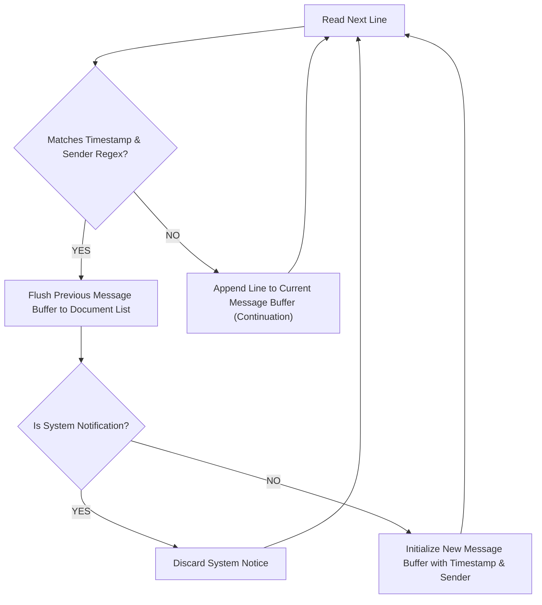

[← Back to Showcase Home](./index)

<div style="display: flex; gap: 0.5rem; margin-bottom: 1.5rem; flex-wrap: wrap;">
  <span class="badge badge-green">Pull Request #563</span>
  <span class="badge badge-purple">Issue #5836</span>
  <span class="badge badge-blue">Status: Verified & Passing</span>
</div>

# Turning Group Chats into Knowledge Graphs: Ingesting WhatsApp Exports into Cognee

In distributed engineering teams, incident response groups, and open-source contributor chats, crucial architectural decisions and bug discussions happen on WhatsApp. Weeks before an issue is logged in Jira or GitHub, the root cause was already diagnosed inside a group thread.

However, extracting semantic meaning from exported WhatsApp logs is notoriously tricky. Exported text files are messy:
- Message timestamps vary widely depending on whether the user's phone is configured for US, European, or 12h/24h time formatting.
- Complex messages span multiple lines, breaking simple line-by-line parsers.
- WhatsApp automatically injects system notices ("Messages and calls are end-to-end encrypted", "John added Sarah") that clutter embeddings.
- Exports are often bundled as `.zip` archives containing attached media alongside `_chat.txt`.

In [topoteretes/cognee#5836](https://github.com/topoteretes/cognee/issues/5836), the community requested a dedicated connector to ingest WhatsApp exports directly into Cognee's cognitive graph.

---

## 1. The Challenges of Unstructured Chat Logs

A single raw export file contains three major pitfalls:

### 1.1 Inconsistent Regional Timestamps
Different phones export timestamps with different date orders, separators, and brackets:
```text
25/10/2026, 14:30 - Alex: Migrating to PostgreSQL 16 tonight
10/25/26, 2:30 PM - Alex: Migrating to PostgreSQL 16 tonight
[25.10.26, 14:30:15] Alex: Migrating to PostgreSQL 16 tonight
```

### 1.2 Multi-line Message Fragmenting
When engineers paste code snippets or write multi-paragraph messages:
```text
25/10/2026, 14:32 - Alex: Here is the proposed schema:
CREATE TABLE users (
    id SERIAL PRIMARY KEY,
    email VARCHAR(255)
);
```
Naive parsers treat `CREATE TABLE users (` as a new message from an unknown sender or discard it entirely.

### 1.3 System Notification Pollution
System notices do not represent human discourse:
```text
25/10/2026, 14:00 - Messages and calls are end-to-end encrypted. No one outside of this chat can read them.
25/10/2026, 14:05 - Sarah added John
25/10/2026, 14:10 - You changed the subject to "DB Migration War Room"
```

---

## 2. Parser Architecture

In [`cognee_community_connector_whatsapp/whatsapp.py`](file:///Users/balaji/github/cognee-community/packages/connector/whatsapp/cognee_community_connector_whatsapp/whatsapp.py), we designed a state-machine parser:



---

## 3. In-Memory ZIP Archive Handling

WhatsApp exports are commonly downloaded as `.zip` packages. Instead of forcing users to extract the archive to disk, our connector inspects the file header and decompresses the chat text stream in memory:

```python
import io
import zipfile
from pathlib import Path

def open_chat_stream(file_path: Path):
    if file_path.suffix.lower() == ".zip":
        with zipfile.ZipFile(file_path, "r") as z:
            for name in z.namelist():
                if name.endswith(".txt") and not name.startswith("__MACOSX"):
                    return io.TextIOWrapper(z.open(name), encoding="utf-8")
        raise FileNotFoundError(f"No .txt chat export found inside {file_path}")
    return open(file_path, "r", encoding="utf-8")
```

---

## 4. Cognee Document Model

Every parsed chat entry is yielded with `DOCUMENT_SOURCE_ATTR = "whatsapp"` and clean metadata:

```python
{
    "sender": "Alex Chen",
    "timestamp": "2026-10-25T14:32:00",
    "text": "Here is the proposed schema:\nCREATE TABLE users (\n    id SERIAL PRIMARY KEY,\n    email VARCHAR(255)\n);",
    "cognee_document_source": "whatsapp",
    "conversation_id": "db_migration_war_room.txt"
}
```

When ingested through `cognee.remember()`, Cognee automatically links entities (people, technologies, decisions) into an interactive knowledge graph.

---

## 5. Quickstart Example

```python
import asyncio
import cognee
from cognee_community_connector_whatsapp import whatsapp_chats

async def main():
    source = whatsapp_chats(file_or_dir_path="./chat_exports/architecture_war_room.zip")

    # Ingest chat history into Cognee
    await cognee.remember(source, dataset_name="team_discussions")

    # Query the knowledge graph
    answer = await cognee.search("What was Alex's proposed schema for the users table?")
    print(answer)

if __name__ == "__main__":
    asyncio.run(main())
```

---

## Related Connectors in this Series
- Need email communications alongside group chats? See [09. IMAP Mailbox Connector](./09_imap_email_mailbox_connector).
- Need forum discussions and community reactions? See [06. Hacker News Discussions](./06_hackernews_community_pulse).

Check out the full implementation and tests in [Pull Request #563](https://github.com/topoteretes/cognee-community/pull/563).
