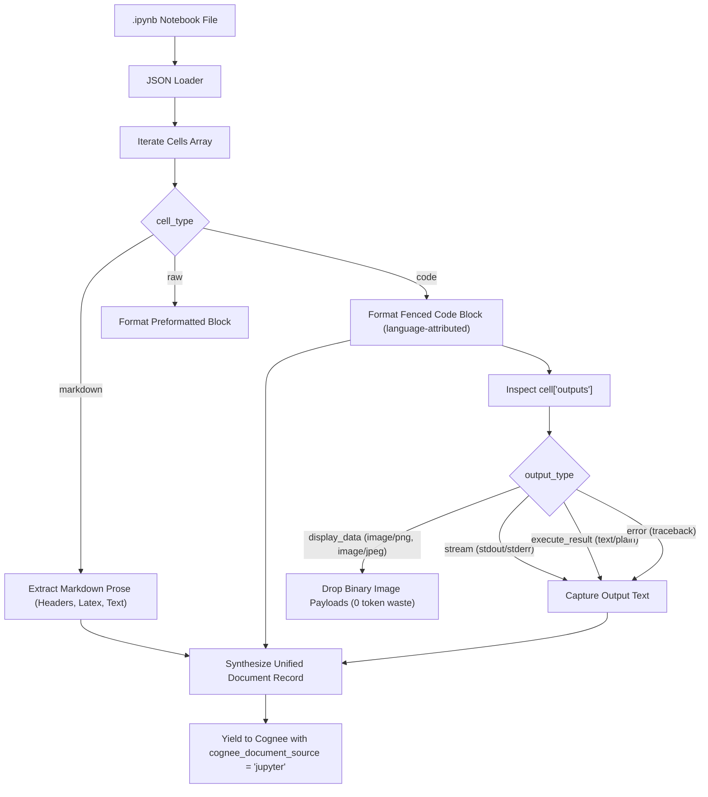

[← Back to Showcase Home](./index)

<div style="display: flex; gap: 0.5rem; margin-bottom: 1.5rem; flex-wrap: wrap;">
  <span class="badge badge-purple">Pull Request #564</span>
  <span class="badge badge-blue">Issue #5509</span>
  <span class="badge badge-green">Status: Verified & Passing</span>
</div>

# Bridging Code and Reasoning: Ingesting Jupyter Notebooks (.ipynb) into Cognee

Data scientists and machine learning engineers treat Jupyter Notebooks (`.ipynb`) as living computational lab records. A well-written notebook blends theoretical background, data preprocessing, model training scripts, and metric evaluation outputs into a cohesive document.

However, raw `.ipynb` files are fundamentally ill-suited for direct language model ingestion:
- **JSON Metadata Overhead**: An `.ipynb` file is a massive JSON tree containing cell execution counts, display priorities, MIME registries, and kernel specifications.
- **Base64 Binary Waste**: Visualization libraries (`matplotlib`, `seaborn`) embed inline base64 image strings (`data:image/png;base64,iVBORw...`). Passing megabytes of base64 text into an embedding model wastes context window tokens and degrades vector retrieval accuracy.
- **Silent Loss of Outputs**: Discarding all outputs throws away vital experimental findings—such as precision/recall tables, regression metrics, and exception tracebacks that explain why a training run failed.

In [topoteretes/cognee#5509](https://github.com/topoteretes/cognee/issues/5509), the community asked for a dedicated connector to structure notebooks for AI knowledge graphs.

---

## 1. Technical Architecture & Cell Decomposition

In [`cognee_community_connector_jupyter/jupyter.py`](file:///Users/balaji/github/cognee-community/packages/connector/jupyter/cognee_community_connector_jupyter/jupyter.py), we implemented an intelligent parser based on the Jupyter Notebook v4 JSON specification.



---

## 2. Code Walkthrough

```python
import json
from pathlib import Path
import dlt
from cognee.shared.logging import get_logger

logger = get_logger("cognee_community_connector_jupyter")

def parse_notebook(notebook_path: Path) -> dict:
    with open(notebook_path, "r", encoding="utf-8") as f:
        data = json.load(f)

    kernel_language = (
        data.get("metadata", {}).get("language_info", {}).get("name", "python")
    )
    document_sections = [f"# {notebook_path.name}\n"]

    for idx, cell in enumerate(data.get("cells", [])):
        cell_type = cell.get("cell_type")
        source = "".join(cell.get("source", []))

        if cell_type == "markdown":
            document_sections.append(f"\n{source}\n")
        elif cell_type == "code":
            document_sections.append(
                f"\n```{kernel_language}\n{source}\n```"
            )
            # Process outputs
            outputs = []
            for out in cell.get("outputs", []):
                out_type = out.get("output_type")
                if out_type == "stream":
                    outputs.append("".join(out.get("text", [])))
                elif out_type in ("execute_result", "display_data"):
                    text_data = out.get("data", {}).get("text/plain")
                    if text_data:
                        outputs.append("".join(text_data))
                elif out_type == "error":
                    trace = "\n".join(out.get("traceback", []))
                    outputs.append(f"Error: {out.get('ename')}: {out.get('evalue')}\n{trace}")

            if outputs:
                document_sections.append(
                    f"\n**Execution Output:**\n```\n{''.join(outputs).strip()}\n```\n"
                )

    return {
        "title": notebook_path.name,
        "content": "\n".join(document_sections),
        "language": kernel_language,
        "cognee_document_source": "jupyter",
        "file_path": str(notebook_path.resolve()),
    }
```

---

## 3. Real-World AI Capabilities

1. **Autonomous Code Reuse**: AI coding assistants can query your company's proprietary data science notebooks to discover how previous engineers performed feature engineering or connected to internal feature stores.
2. **Automated Documentation**: Agents can summarize entire directories of exploratory notebooks into clean technical reports without manual intervention.
3. **Reproducibility Verification**: Trace model training conclusions directly back to the exact code cell and printed evaluation metric.

---

## 4. Quickstart Ingestion

```python
import asyncio
import cognee
from cognee_community_connector_jupyter import jupyter_notebooks

async def main():
    # Recursively ingest all notebooks in the project
    source = jupyter_notebooks(path="./experiments/churn_prediction/")

    await cognee.remember(source, dataset_name="data_science_repo")

    # Ask Cognee about the findings
    insight = await cognee.search("Which hyperparameters yielded the highest F1 score in the churn experiment?")
    print(insight)

if __name__ == "__main__":
    asyncio.run(main())
```

---

## Related Connectors in this Series
- Need research papers referenced in your notebooks? See [05. arXiv Research Papers](./05_arxiv_research_papers).
- Need automated test and build runs tracked? See [10. GitHub Actions Diagnostics](./10_github_actions_ci_diagnostics).

Check out the full implementation and tests in [Pull Request #564](https://github.com/topoteretes/cognee-community/pull/564).
