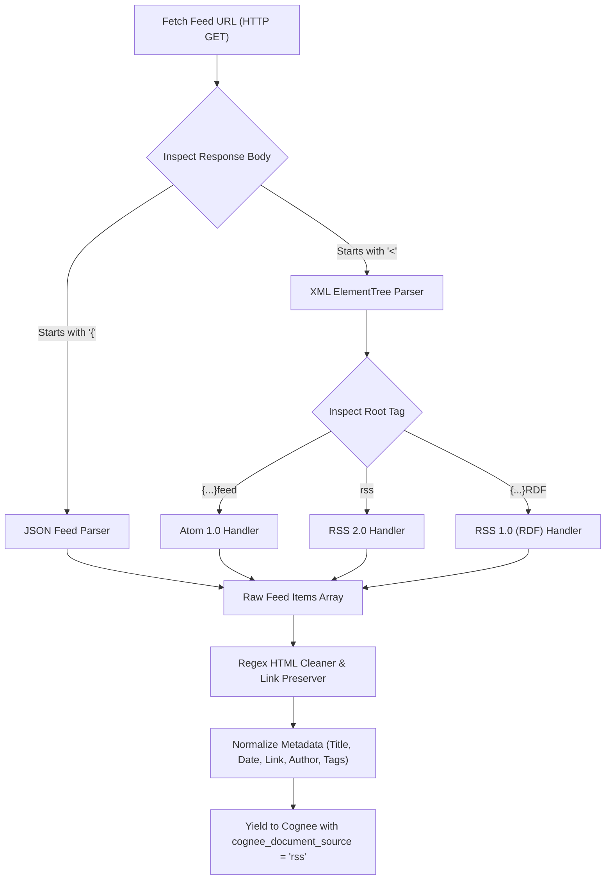

[← Back to Showcase Home](./index)

<div style="display: flex; gap: 0.5rem; margin-bottom: 1.5rem; flex-wrap: wrap;">
  <span class="badge badge-amber">Pull Request #565</span>
  <span class="badge badge-blue">Issue #4804</span>
  <span class="badge badge-green">Status: Verified & Passing</span>
</div>

# Always Up-to-Date AI: Building a Resilient RSS, Atom & JSON Feed Connector for Cognee

Autonomous AI agents cannot operate on static pre-training weights alone. To monitor emerging zero-day vulnerabilities, competitor product announcements, or engineering updates from key open-source repositories, agents require a continuous stream of fresh data.

Across the internet, **syndication feeds remain the open web's most dependable, protocol-agnostic notification mechanism**.

However, ingesting web feeds reliably is notoriously difficult because feed standards have splintered across three decades:
- **RSS 2.0**: The classic `<rss><channel><item>` structure.
- **RSS 1.0 (RDF)**: XML namespace heavy with `<rdf:RDF>` and `<item rdf:about="...">`.
- **Atom XML**: The IETF standard with `<feed><entry>` tags and XML namespaces (`http://www.w3.org/2005/Atom`).
- **JSON Feed**: Modern JSON-based feeds (`items: [{id, title, content_html}]`).

Furthermore, feed item bodies often contain raw HTML with inline styling, scripts, tracking pixels, and ads that degrade vector embeddings if left unsanitized.

In [topoteretes/cognee#4804](https://github.com/topoteretes/cognee/issues/4804), the community called for an all-in-one syndication feed connector.

---

## 1. Multi-Format Detection Architecture

In [`cognee_community_connector_rss/rss.py`](file:///Users/balaji/github/cognee-community/packages/connector/rss/cognee_community_connector_rss/rss.py), we implemented an auto-detecting ingestion engine:



---

## 2. In-Depth HTML Sanitization

Raw feed content frequently contains tracking pixels, inline styling, and scripts. We engineered an efficient regex cleaner that:
- Strips `<script>`, `<style>`, and `<iframe>` blocks.
- Transforms anchor links (`<a href="url">text</a>`) into markdown links (`[text](url)`).
- Collapses whitespace and replaces `<br>` / `<p>` tags with clean markdown paragraph breaks.
- Unescapes HTML entities (`&amp;`, `&quot;`, `&#39;`).

```python
import html
import re

def clean_html(raw_html: str) -> str:
    if not raw_html:
        return ""
    # Remove script and style elements
    text = re.sub(r"<(script|style).*?</\1>", "", raw_html, flags=re.DOTALL | re.IGNORECASE)
    # Convert links to markdown
    text = re.sub(r'<a\s+[^>]*href=["\']([^"\']+)["\'][^>]*>(.*?)</a>', r"[\2](\1)", text, flags=re.DOTALL | re.IGNORECASE)
    # Replace block tags with newlines
    text = re.sub(r"<(br|p|div|li)[^>]*>", "\n", text, flags=re.IGNORECASE)
    # Strip remaining tags
    text = re.sub(r"<[^>]+>", "", text)
    # Unescape entities and normalize whitespace
    return re.sub(r"\n{3,}", "\n\n", html.unescape(text)).strip()
```

---

## 3. Supported Feed Standards Comparison

| Format | Specification | Content Extraction Strategy | Namespace Handling |
|---|---|---|---|
| **RSS 2.0** | UserLand RSS 2.0 | Prefers `<content:encoded>`, falls back to `<description>` | Strips optional namespaces |
| **Atom 1.0** | IETF RFC 4287 | Checks `<content>` then `<summary>` | Resolves `{http://www.w3.org/2005/Atom}` |
| **RSS 1.0 (RDF)** | W3C RDF Site Summary | Extracts `<item>` elements inside `<rdf:RDF>` | Handles RDF attributes |
| **JSON Feed** | JSON Feed v1.1 | Prefers `content_html`, fallback `content_text` | Native JSON keys |

---

## 4. Quickstart: Building a Continuous Tech Radar

```python
import asyncio
import cognee
from cognee_community_connector_rss import rss_feeds

async def main():
    tech_feeds = [
        "https://simonwillison.net/atom/everything/",
        "https://news.ycombinator.com/rss",
        "https://feeds.feedburner.com/PythonInsider",
    ]

    source = rss_feeds(feed_urls=tech_feeds, max_items_per_feed=20)

    # Ingest and continuously update agent memory
    await cognee.remember(source, dataset_name="tech_news")

    # Ask the agent about today's updates
    news = await cognee.search("What were the latest releases announced in Python?")
    print(news)

if __name__ == "__main__":
    asyncio.run(main())
```

---

## Related Connectors in this Series
- Looking specifically for Substack publications? See [08. Substack Newsletters](./08_substack_newsletter_connector).
- Looking for Hacker News discussion threads? See [06. Hacker News Discussions](./06_hackernews_community_pulse).

Check out the full implementation and tests in [Pull Request #565](https://github.com/topoteretes/cognee-community/pull/565).
