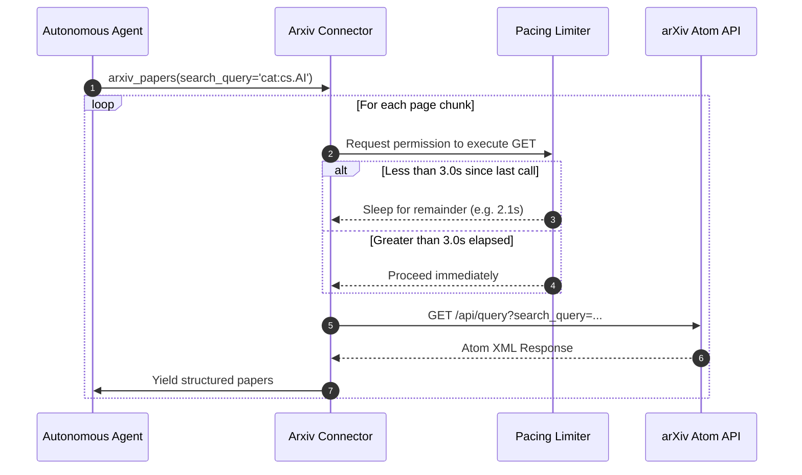

[← Back to Showcase Home](./index)

<div style="display: flex; gap: 0.5rem; margin-bottom: 1.5rem; flex-wrap: wrap;">
  <span class="badge badge-cyan">Pull Request #566</span>
  <span class="badge badge-blue">Issue #4806</span>
  <span class="badge badge-green">Status: Verified & Passing</span>
</div>

# Autonomous Scientific Research: Bringing arXiv Papers into Cognee Knowledge Graphs

In cutting-edge domains like deep learning, quantum computing, and computational biology, the pace of discovery outstrips traditional peer review. Over 2,000 preprints are submitted to **arXiv.org** every single week.

For autonomous AI research agents (such as literature review bots, patent searchers, or hypothesis-generation assistants), ingesting arXiv papers directly into a structured knowledge graph is transformative. Agents can track how new model architectures evolve, identify cross-disciplinary citations, and find prior art.

However, programmatically ingesting arXiv at scale has strict rules:
1. **The 3-Second Rule**: arXiv strictly enforces a policy requiring API clients to pause at least 3 seconds between requests to avoid server overload. Clients that ignore this risk immediate IP-level bans.
2. **Complex Query Syntax**: arXiv's Atom XML API supports complex combinations of category filters (`cat:cs.AI`, `cat:cs.LG`), Boolean operators (`AND`, `OR`, `ANDNOT`), and ID lookups.
3. **Structured Paper Metadata**: Extracting author lists with affiliations, primary subject classifications, DOIs, and direct PDF links requires robust XML handling.

In [topoteretes/cognee#4806](https://github.com/topoteretes/cognee/issues/4806), the community requested a compliant, high-performance arXiv data-source connector.

---

## 1. Request Pacing Architecture

To protect arXiv's servers and prevent IP banning, our connector enforces asynchronous request pacing:



---

## 2. Atom XML Paper Schema Mapping

arXiv returns search results formatted as an Atom XML syndication feed, using specialized arXiv XML namespaces (`xmlns:arxiv="http://arxiv.org/schemas/atom"`).

In [`cognee_community_connector_arxiv/arxiv.py`](file:///Users/balaji/github/cognee-community/packages/connector/arxiv/cognee_community_connector_arxiv/arxiv.py), we map XML elements into Cognee document records:

```python
import xml.etree.ElementTree as ET

ATOM_NS = {"atom": "http://www.w3.org/2005/Atom", "arxiv": "http://arxiv.org/schemas/atom"}

def parse_arxiv_entry(entry: ET.Element) -> dict:
    arxiv_id = (entry.findtext("atom:id", namespaces=ATOM_NS) or "").split("/abs/")[-1]
    title = re.sub(r"\s+", " ", entry.findtext("atom:title", namespaces=ATOM_NS) or "").strip()
    summary = re.sub(r"\s+", " ", entry.findtext("atom:summary", namespaces=ATOM_NS) or "").strip()

    authors = [
        author.findtext("atom:name", namespaces=ATOM_NS)
        for author in entry.findall("atom:author", namespaces=ATOM_NS)
        if author.findtext("atom:name", namespaces=ATOM_NS)
    ]

    primary_cat = entry.find("arxiv:primary_category", namespaces=ATOM_NS)
    cat_code = primary_cat.get("term") if primary_cat is not None else None

    # Locate PDF download URL
    pdf_link = None
    for link in entry.findall("atom:link", namespaces=ATOM_NS):
        if link.get("title") == "pdf":
            pdf_link = link.get("href")

    return {
        "title": title,
        "content": f"Title: {title}\nAuthors: {', '.join(authors)}\nCategory: {cat_code}\n\nAbstract:\n{summary}",
        "arxiv_id": arxiv_id,
        "authors": authors,
        "category": cat_code,
        "pdf_url": pdf_link,
        "cognee_document_source": "arxiv",
    }
```

---

## 3. Querying by Taxonomy & Category

The connector supports arXiv's official subject category codes:
- `cs.AI`: Artificial Intelligence
- `cs.LG`: Machine Learning
- `cs.CL`: Computation and Language (NLP)
- `stat.ML`: Machine Learning (Statistics)
- `quant-ph`: Quantum Physics

---

## 4. Quickstart: Autonomous Literature Review

```python
import asyncio
import cognee
from cognee_community_connector_arxiv import arxiv_papers

async def main():
    source = arxiv_papers(
        search_query='cat:cs.AI AND all:"knowledge graphs" AND all:"reasoning"',
        max_results=30,
        sort_by="submittedDate",
    )

    # Stream into Cognee's cognitive graph
    await cognee.remember(source, dataset_name="graph_reasoning_papers")

    # Ask the agent to synthesize literature trends
    synthesis = await cognee.search(
        "What are the main graph-augmented reasoning methods proposed in recent preprints?"
    )
    print(synthesis)

if __name__ == "__main__":
    asyncio.run(main())
```

---

## Related Connectors in this Series
- Need life sciences and clinical research literature? See [07. PubMed Biomedical Literature](./07_pubmed_biomedical_literature).
- Need Jupyter notebooks reproducing paper benchmarks? See [03. Jupyter Notebook Reader](./03_jupyter_notebook_reader).

Check out the full implementation and tests in [Pull Request #566](https://github.com/topoteretes/cognee-community/pull/566).
