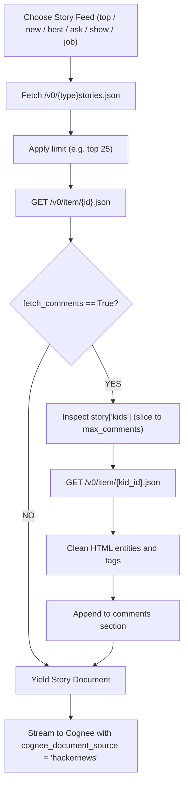

[← Back to Showcase Home](./index)

<div style="display: flex; gap: 0.5rem; margin-bottom: 1.5rem; flex-wrap: wrap;">
  <span class="badge badge-amber">Pull Request #567</span>
  <span class="badge badge-blue">Issue #4805</span>
  <span class="badge badge-green">Status: Verified & Passing</span>
</div>

# Capturing Developer Sentiment: Ingesting Hacker News Discussions into Cognee

For more than two decades, **Hacker News (Y Combinator)** has served as the global town square for software engineers, startup founders, and technologists. It is where new open-source projects are launched, architecture paradigms are debated, and production post-mortems are scrutinized.

For autonomous AI agents, Hacker News offers a goldmine of real-time community sentiment:
- Which newly launched libraries are gaining developer traction?
- What are engineers' honest opinions regarding a specific cloud vendor outage?
- What architectural tradeoffs are discussed in "Show HN" launches?

In [topoteretes/cognee#4805](https://github.com/topoteretes/cognee/issues/4805), the community called for a native Hacker News data-source connector.

---

## 1. Navigating the Hacker News Firebase REST API

Hacker News exposes its live database through Firebase at `https://hacker-news.firebaseio.com/v0/`. Unlike traditional relational databases with join queries, Hacker News uses a purely document-oriented hierarchical tree:

```
Story Item (#39100000)
  ├── kids: [39100010, 39100020, 39100030]
  │           └── Comment #39100010
  │                 └── kids: [39100045] -> Nested reply
```

To ingest a story along with its top comments, our connector must:
1. Fetch the story item (`/v0/item/{story_id}.json`).
2. Traverse its `kids` array.
3. Filter out `deleted` or `dead` comments.
4. Unescape raw HTML entities and decode formatting.



---

## 2. In-Depth Code Walkthrough

In [`cognee_community_connector_hackernews/hackernews.py`](file:///Users/balaji/github/cognee-community/packages/connector/hackernews/cognee_community_connector_hackernews/hackernews.py):

```python
import html
import re
import urllib.request
import json
import dlt

HN_BASE_URL = "https://hacker-news.firebaseio.com/v0"

def fetch_json(url: str) -> dict | list | None:
    req = urllib.request.Request(url, headers={"User-Agent": "CogneeHackerNewsConnector/1.0"})
    with urllib.request.urlopen(req, timeout=10) as response:
        return json.loads(response.read().decode("utf-8"))

@dlt.resource(name="hackernews_items", write_disposition="replace")
def hackernews_stories(
    story_type: str = "top",
    limit: int = 20,
    fetch_comments: bool = False,
    max_comments: int = 5,
):
    ids_url = f"{HN_BASE_URL}/{story_type}stories.json"
    story_ids = fetch_json(ids_url) or []

    for story_id in story_ids[:limit]:
        item = fetch_json(f"{HN_BASE_URL}/item/{story_id}.json")
        if not item or item.get("deleted") or item.get("dead"):
            continue

        title = item.get("title", "")
        url = item.get("url", f"https://news.ycombinator.com/item?id={story_id}")
        score = item.get("score", 0)
        by = item.get("by", "unknown")
        text = clean_html(item.get("text", ""))

        content_parts = [
            f"# {title}",
            f"**Author:** {by} | **Score:** {score} points | **URL:** {url}\n",
        ]
        if text:
            content_parts.append(f"### Submission Text:\n{text}\n")

        if fetch_comments and "kids" in item:
            content_parts.append("### Top Community Comments:\n")
            for kid_id in item.get("kids", [])[:max_comments]:
                comment = fetch_json(f"{HN_BASE_URL}/item/{kid_id}.json")
                if comment and not comment.get("deleted") and not comment.get("dead"):
                    c_author = comment.get("by", "anonymous")
                    c_text = clean_html(comment.get("text", ""))
                    content_parts.append(f"- **{c_author}**: {c_text}\n")

        yield {
            "title": title,
            "content": "\n".join(content_parts),
            "story_id": story_id,
            "score": score,
            "by": by,
            "url": url,
            "cognee_document_source": "hackernews",
        }
```

---

## 3. Real-World Agent Use Cases

1. **Competitor & Open Source Tracking**: Agents can monitor the `show` feed to instantly discover new open-source vector databases, agent frameworks, or developer tooling.
2. **Community Bug & Post-Mortem Intelligence**: Ingest the `top` feed during major cloud outages (AWS, Cloudflare) to extract community workarounds and root-cause analyses.
3. **Sentiment Analysis**: Evaluate whether a new technology or API change is receiving praise or criticism from senior engineers.

---

## 4. Quickstart Ingestion

```python
import asyncio
import cognee
from cognee_community_connector_hackernews import hackernews_stories

async def main():
    # Ingest top Ask HN and Show HN submissions
    source = hackernews_stories(
        story_type="top",
        limit=25,
        fetch_comments=True,
        max_comments=8,
    )

    await cognee.remember(source, dataset_name="hacker_news_pulse")

    # Ask the agent about current discussions
    analysis = await cognee.search("What are developers saying about WebAssembly in production?")
    print(analysis)

if __name__ == "__main__":
    asyncio.run(main())
```

---

## Related Connectors in this Series
- Need broad RSS and Atom syndication? See [04. RSS & Atom Feeds](./04_rss_atom_json_feed).
- Need independent tech newsletters? See [08. Substack Newsletters](./08_substack_newsletter_connector).

Check out the full implementation and tests in [Pull Request #567](https://github.com/topoteretes/cognee-community/pull/567).
