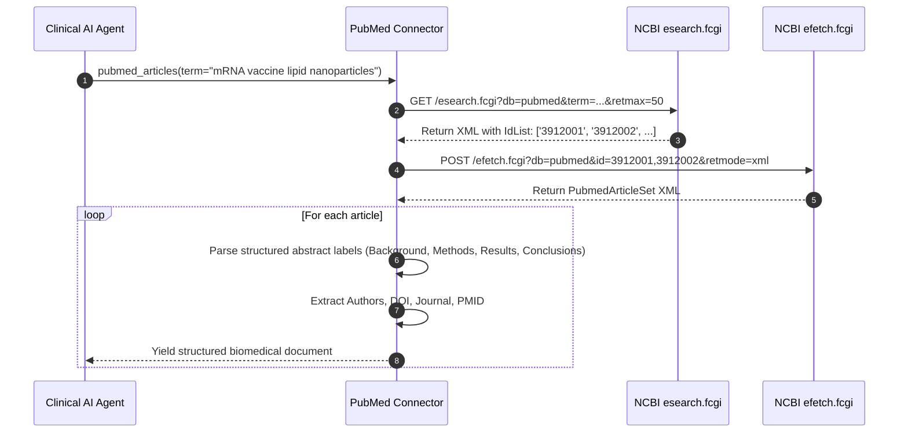

[← Back to Showcase Home](./index)

<div style="display: flex; gap: 0.5rem; margin-bottom: 1.5rem; flex-wrap: wrap;">
  <span class="badge badge-blue">Pull Request #568</span>
  <span class="badge badge-purple">Issue #4807</span>
  <span class="badge badge-green">Status: Verified & Passing</span>
</div>

# Biomedical Knowledge Graphs: Connecting PubMed and NCBI E-utilities to Cognee

The National Library of Medicine's **PubMed** database comprises more than 36 million citations for biomedical literature from MEDLINE, life science journals, and online books. For AI agents assisting clinical researchers, oncologists, or pharmacologists, PubMed is the primary source of truth.

However, extracting papers from NCBI (National Center for Biotechnology Information) requires navigating their specialized **Entrez E-utilities** architecture:
1. **Two-Stage Retrieval**: You cannot simply download papers by keyword. You must first query `esearch.fcgi` to obtain a list of unique PubMed Identifiers (PMIDs), and then pass those IDs to `efetch.fcgi` to download the article XML payloads.
2. **Structured Abstract XML**: Modern scientific abstracts do not store plain text; they contain multiple labeled XML nodes (`<AbstractText Label="BACKGROUND">`, `<AbstractText Label="METHODS">`, etc.). Naive string extraction loses the distinction between hypotheses and conclusions.
3. **Complex Author Taxonomies**: Medical papers often feature dozens of authors, consortiums, and institutional affiliations.

In [topoteretes/cognee#4807](https://github.com/topoteretes/cognee/issues/4807), the community requested a dedicated PubMed connector.

---

## 1. The Two-Stage NCBI Entrez Pipeline

NCBI requires a decoupled search-and-fetch workflow:



---

## 2. Preserving Clinical Semantics in Structured Abstracts

In modern medical literature, abstracts are segmented into explicit clinical phases:
```xml
<Abstract>
    <AbstractText Label="BACKGROUND">Lipid nanoparticles require specific ionizable lipids for hepatic delivery.</AbstractText>
    <AbstractText Label="METHODS">We conducted a randomized Phase II trial on 120 patients.</AbstractText>
    <AbstractText Label="RESULTS">Serum antibody titers increased by 4.2-fold without severe adverse events.</AbstractText>
    <AbstractText Label="CONCLUSIONS">The formulation demonstrates superior immunogenicity and safety.</AbstractText>
</Abstract>
```

Naive text extraction merges these sections together without headings, which impairs the language model's ability to distinguish an experimental hypothesis from a confirmed clinical finding.

In [`cognee_community_connector_pubmed/pubmed.py`](file:///Users/balaji/github/cognee-community/packages/connector/pubmed/cognee_community_connector_pubmed/pubmed.py), we preserve each section's clinical label:

```python
abstract_parts = []
abstract_elem = article.find(".//Abstract")
if abstract_elem is not None:
    for text_node in abstract_elem.findall("AbstractText"):
        label = text_node.get("Label")
        text = (text_node.text or "").strip()
        if label:
            abstract_parts.append(f"### {label.title()}:\n{text}")
        else:
            abstract_parts.append(text)

formatted_abstract = "\n\n".join(abstract_parts)
```

---

## 3. Extracted Metadata Schema

Every yielded paper record provides high-precision bibliographic keys:
- `pmid`: Unique PubMed Identifier
- `pmcid`: PubMed Central open-access ID (if available)
- `doi`: Digital Object Identifier
- `title`: Article title
- `journal`: Publishing medical journal
- `pub_date`: Publication year and date
- `authors`: Array of authors (formatted as `LastName ForeName`)
- `cognee_document_source`: `"pubmed"`

---

## 4. Quickstart: Clinical Literature Agent

```python
import asyncio
import cognee
from cognee_community_connector_pubmed import pubmed_articles

async def main():
    source = pubmed_articles(
        term="CAR-T cell therapy solid tumors resistance",
        max_results=30,
        email="ai_researcher@clinic.org", # NCBI respectful usage identification
    )

    # Ingest clinical papers into Cognee's medical knowledge graph
    await cognee.remember(source, dataset_name="oncology_clinical_trials")

    # Query the clinical knowledge graph
    findings = await cognee.search(
        "What immunosuppressive mechanisms in the tumor microenvironment cause CAR-T exhaustion?"
    )
    print(findings)

if __name__ == "__main__":
    asyncio.run(main())
```

---

## Related Connectors in this Series
- Need computer science and machine learning research? See [05. arXiv Research Papers](./05_arxiv_research_papers).
- Need Jupyter notebooks analyzing clinical trial data? See [03. Jupyter Notebook Reader](./03_jupyter_notebook_reader).

Check out the full implementation and tests in [Pull Request #568](https://github.com/topoteretes/cognee-community/pull/568).
