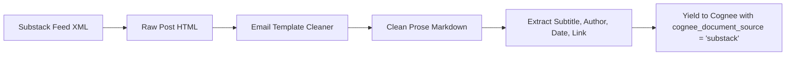

[← Back to Showcase Home](./index)

<div style="display: flex; gap: 0.5rem; margin-bottom: 1.5rem; flex-wrap: wrap;">
  <span class="badge badge-purple">Pull Request #569</span>
  <span class="badge badge-blue">Issue #4810</span>
  <span class="badge badge-green">Status: Verified & Passing</span>
</div>

# Ingesting Thought Leadership: The Substack Newsletter Connector for Cognee

Over the last five years, high-caliber domain analysis has migrated to independent newsletters. From semiconductor architecture and semiconductor supply chains (SemiAnalysis) to macroeconomic commentary and AI safety strategy, domain experts publish their most detailed essays on **Substack**.

Unlike transient social media posts or brief news headlines, Substack essays are long-form, thoroughly referenced, and rich in domain insights.

However, ingesting Substack publications programmatically poses unique hurdles:
1. **Diverse URL Conventions**: Some creators publish on standard subdomains (`thealgorithmicbridge.substack.com`), while others use custom vanity domains (`astralcodexten.com` or `strangeloopcanon.com`).
2. **HTML Email Formatting**: Substack's HTML is tailored for email rendering, containing email action buttons, subscribe forms, tracking beacons, and complex CSS tables.
3. **Feed Structure**: Standard RSS endpoints omit subtitle metadata and include HTML artifacts that must be converted into clean markdown.

In [topoteretes/cognee#4810](https://github.com/topoteretes/cognee/issues/4810), the community requested a dedicated Substack connector.

---

## 1. Universal Publication URL Normalization

In [`cognee_community_connector_substack/substack.py`](file:///Users/balaji/github/cognee-community/packages/connector/substack/cognee_community_connector_substack/substack.py), we designed a flexible resolver that handles any input format:

```python
def normalize_substack_feed(identifier: str) -> str:
    cleaned = identifier.strip().rstrip("/")
    if cleaned.startswith("http://") or cleaned.startswith("https://"):
        return f"{cleaned}/feed"
    if ".substack.com" in cleaned:
        return f"https://{cleaned}/feed"
    # Plain publication handle
    return f"https://{cleaned}.substack.com/feed"
```

### Examples Handled Transparently:
- Bare handle: `"semianalysis"` → `https://semianalysis.substack.com/feed`
- Subdomain: `"thealgorithmicbridge.substack.com"` → `https://thealgorithmicbridge.substack.com/feed`
- Custom domain: `"https://stratechery.com"` → `https://stratechery.com/feed`

---

## 2. Stripping Email Layout Clutter

Substack feed items package post contents within email template HTML, including subscribe widgets, pledge prompts, and social share buttons. 

Our connector prunes these elements while transforming core article formatting into clean markdown:
- Converts headers (`<h1>` to `<h6>`) to markdown `#` prefixes.
- Converts blockquotes and pull quotes into markdown `>` lines.
- Translates ordered and unordered lists into clean indentation.
- Strips subscription CTAs, pledge footers, and pixel trackers.



---

## 3. Emitted Schema & Document Model

```python
{
    "title": "The AI Memory Wall and HBM4 Architectures",
    "subtitle": "Why High Bandwidth Memory packaging dictates next-generation accelerator roadmaps",
    "author": "Dylan Patel",
    "published_at": "2026-10-20T08:00:00Z",
    "link": "https://semianalysis.com/p/ai-memory-wall-hbm4",
    "content": "# The AI Memory Wall and HBM4 Architectures\n\n...",
    "cognee_document_source": "substack"
}
```

---

## 4. Quickstart: Industry Thought-Leader Monitoring

```python
import asyncio
import cognee
from cognee_community_connector_substack import substack_publications

async def main():
    target_newsletters = [
        "semianalysis",            # Hardware and chip manufacturing
        "thealgorithmicbridge",    # AI research commentary
        "https://stratechery.com", # Custom domain tech business analysis
    ]

    source = substack_publications(
        publications=target_newsletters,
        max_posts_per_pub=10,
    )

    await cognee.remember(source, dataset_name="industry_newsletters")

    # Ask the agent for synthesized domain perspectives
    perspective = await cognee.search(
        "What are the supply chain bottlenecks for next-generation CoWoS packaging?"
    )
    print(perspective)

if __name__ == "__main__":
    asyncio.run(main())
```

---

## Related Connectors in this Series
- Need general syndication feeds and blogs? See [04. RSS & Atom Feeds](./04_rss_atom_json_feed).
- Need developer discussions and community reaction? See [06. Hacker News Discussions](./06_hackernews_community_pulse).

Check out the full implementation and tests in [Pull Request #569](https://github.com/topoteretes/cognee-community/pull/569).
