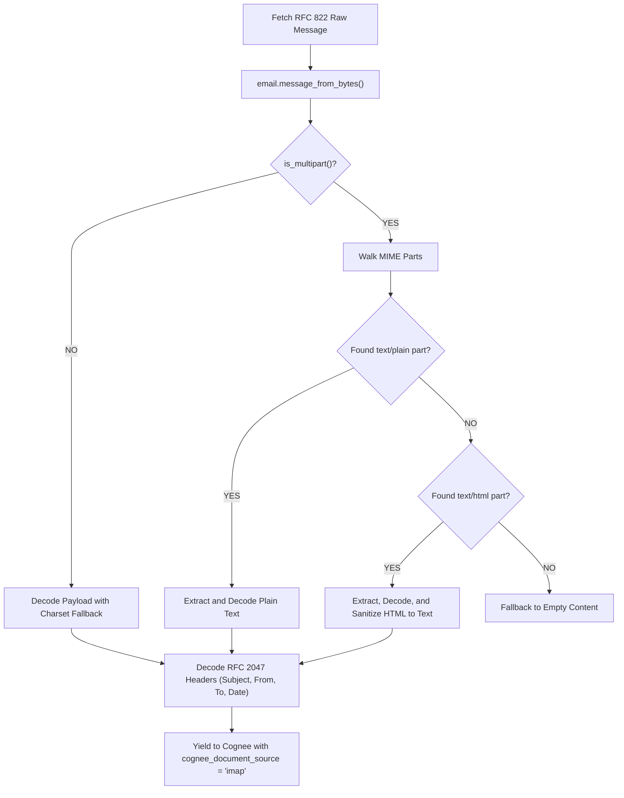

[← Back to Showcase Home](./index)

<div style="display: flex; gap: 0.5rem; margin-bottom: 1.5rem; flex-wrap: wrap;">
  <span class="badge badge-green">Pull Request #570</span>
  <span class="badge badge-blue">Issue #5634</span>
  <span class="badge badge-purple">Status: Verified & Passing</span>
</div>

# Unlocking the Inbox: Building an Enterprise IMAP Email Connector for Cognee

Despite the proliferation of chat apps and issue trackers, **email remains the ultimate enterprise system of record**. Invoices, legal agreements, vendor negotiations, board communications, and customer escalations all reside inside mailboxes.

Connecting an IMAP mailbox to Cognee transforms an autonomous AI agent into an executive-level assistant capable of:
- Answering questions about historical customer agreements.
- Finding which executive approved a contract or budget exception.
- Tracking negotiation threads across multiple counterparties over months.

However, building an email connector that works reliably across Gmail, Microsoft Exchange / Office 365, Yahoo, and private on-premise IMAP servers is notoriously tricky:
1. **RFC 2047 Header Encoding**: Subject lines and sender names often contain non-ASCII characters encoded in base64 or quoted-printable chunks (`=?UTF-8?B?...?=`).
2. **Multipart MIME Complexity**: Modern emails are nested trees of `multipart/alternative`, `multipart/mixed`, and `multipart/related`. A parser must traverse these payloads to find the primary text body while ignoring signature images or PDF attachments.
3. **Security Standards**: Mail servers require either implicit TLS on port 993 or explicit STARTTLS upgrading over port 143.

In [topoteretes/cognee#5634](https://github.com/topoteretes/cognee/issues/5634), the community requested a dedicated IMAP connector.

---

## 1. Multipart MIME Traversal Architecture

Modern emails rarely contain a single plain text body. Instead, they form a complex MIME tree:

```
multipart/mixed
  ├── multipart/alternative
  │     ├── text/plain (Plain text fallback)
  │     └── text/html  (Styled HTML body)
  ├── image/png (Embedded logo)
  └── application/pdf (Contract attachment)
```

In [`cognee_community_connector_imap/imap.py`](file:///Users/balaji/github/cognee-community/packages/connector/imap/cognee_community_connector_imap/imap.py), our traversal algorithm walks the MIME tree with clear fallback priorities:



---

## 2. Robust RFC 2047 Header Decoding

Email headers must conform to ASCII. International characters (accents, emojis, non-Latin alphabets) are encoded using RFC 2047 conventions:
`=?UTF-8?B?U3ViamVjdDogUHLDqXRlcnZpZXc=?=`

Our connector cleanly decodes these headers back into native Python UTF-8 strings:

```python
import email.header

def decode_mime_header(header_value: str | None) -> str:
    if not header_value:
        return ""
    decoded_chunks = []
    for chunk, encoding in email.header.decode_header(header_value):
        if isinstance(chunk, bytes):
            decoded_chunks.append(chunk.decode(encoding or "utf-8", errors="replace"))
        else:
            decoded_chunks.append(str(chunk))
    return "".join(decoded_chunks)
```

---

## 3. Search Filtering & Mailbox Pagination

Instead of pulling entire 100,000-message inboxes, the connector allows targeted criteria:
- Filter unread messages: `search_criterion="UNSEEN"`
- Filter by date threshold: `search_criterion='SINCE "01-Oct-2026"'`
- Filter by sender: `search_criterion='FROM "vendor@acme.com"'`
- Configurable maximum fetch limit: `max_messages=50`

---

## 4. Quickstart: Executive Mailbox Knowledge Retrieval

```python
import asyncio
import cognee
from cognee_community_connector_imap import imap_emails

async def main():
    source = imap_emails(
        host="imap.gmail.com",
        username="assistant@startup.com",
        password="app_specific_secret_password",
        folder="INBOX",
        search_criterion='SINCE "01-Sep-2026"',
        max_messages=100,
    )

    # Ingest email records into Cognee
    await cognee.remember(source, dataset_name="executive_communications")

    # Query the email knowledge graph
    answer = await cognee.search("What was agreed with Acme regarding the SLA compensation clause?")
    print(answer)

if __name__ == "__main__":
    asyncio.run(main())
```

---

## Related Connectors in this Series
- Need chat logs alongside email threads? See [02. WhatsApp Chat Exports](./02_whatsapp_chat_export).
- Need Notion workspace integration for project tasks? See [01. Notion Incremental Sync](./01_notion_incremental_sync).

Check out the full implementation and tests in [Pull Request #570](https://github.com/topoteretes/cognee-community/pull/570).
