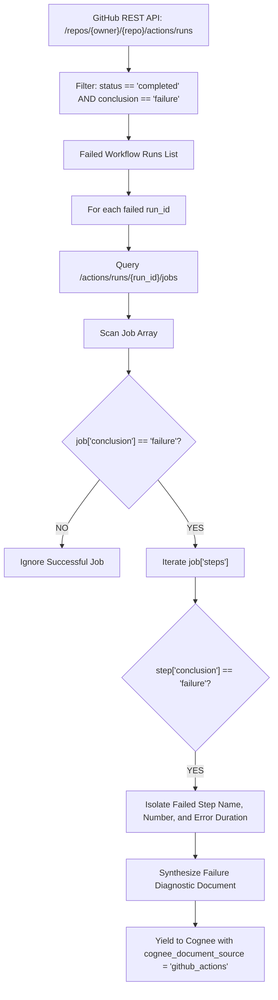

[← Back to Showcase Home](./index)

<div style="display: flex; gap: 0.5rem; margin-bottom: 1.5rem; flex-wrap: wrap;">
  <span class="badge badge-cyan">Pull Request #571</span>
  <span class="badge badge-blue">Issue #5742</span>
  <span class="badge badge-green">Status: Verified & Passing</span>
</div>

# Self-Healing CI/CD: Ingesting GitHub Actions Workflow Runs and Failure Diagnostics into Cognee

In modern software engineering, automated CI/CD pipelines run thousands of integration tests, linter checks, and container builds every day. When a build breaks or an end-to-end test times out, developers must comb through thousands of lines of terminal output to find the root cause:
- Was it a flaky network test?
- Did a dependency release a breaking minor version?
- Is there an unhandled database migration exception?

For autonomous coding agents (such as SWE-bench agents, PR repair bots, or debugging assistants), having direct, structured access to **GitHub Actions workflow runs and failed job logs** is a game changer. Instead of requiring human engineers to manually copy-paste terminal errors into a prompt, Cognee can ingest the failure context directly into its knowledge graph.

In [topoteretes/cognee#5742](https://github.com/topoteretes/cognee/issues/5742), the community requested a dedicated GitHub Actions diagnostics connector.

---

## 1. Automated Failure Isolation Architecture

Rather than dumping entire mega-byte build logs into the knowledge graph, our connector specifically isolates failure points:



---

## 2. In-Depth Code Walkthrough

In [`cognee_community_connector_github_actions/github_actions.py`](file:///Users/balaji/github/cognee-community/packages/connector/github-actions/cognee_community_connector_github_actions/github_actions.py):

```python
import json
import urllib.request
import dlt
from cognee.shared.logging import get_logger

logger = get_logger("cognee_community_connector_github_actions")

def github_api_get(url: str, token: str | None = None) -> dict:
    headers = {
        "Accept": "application/vnd.github+json",
        "User-Agent": "CogneeGitHubActionsConnector/1.0",
    }
    if token:
        headers["Authorization"] = f"Bearer {token}"
    req = urllib.request.Request(url, headers=headers)
    with urllib.request.urlopen(req, timeout=15) as res:
        return json.loads(res.read().decode("utf-8"))

@dlt.resource(name="github_actions_runs", write_disposition="replace")
def github_actions_runs(
    owner: str,
    repo: str,
    status: str | None = None,
    limit: int = 20,
    github_token: str | None = None,
):
    base_url = f"https://api.github.com/repos/{owner}/{repo}/actions"
    runs_url = f"{base_url}/runs?per_page={limit}"
    if status:
        runs_url += f"&status={status}"

    data = github_api_get(runs_url, github_token)
    for run in data.get("workflow_runs", []):
        run_id = run["id"]
        run_name = run.get("name", "Unknown Workflow")
        head_commit = run.get("head_commit", {})
        conclusion = run.get("conclusion")

        doc_lines = [
            f"# Workflow Run: {run_name} (#{run.get('run_number')})",
            f"**Repository:** `{owner}/{repo}`",
            f"**Branch:** `{run.get('head_branch')}` | **Conclusion:** `{conclusion}`",
            f"**Commit:** `{head_commit.get('id', '')[:8]}` - {head_commit.get('message', '').strip()}",
            f"**Triggered by:** `{run.get('actor', {}).get('login')}` | **URL:** {run.get('html_url')}\n",
        ]

        # If run failed, query jobs to pinpoint exact failing steps
        if conclusion == "failure":
            jobs_data = github_api_get(f"{base_url}/runs/{run_id}/jobs", github_token)
            failed_steps = []
            for job in jobs_data.get("jobs", []):
                if job.get("conclusion") == "failure":
                    for step in job.get("steps", []):
                        if step.get("conclusion") == "failure":
                            failed_steps.append({
                                "job": job.get("name"),
                                "step": step.get("name"),
                                "step_num": step.get("number"),
                            })

            if failed_steps:
                doc_lines.append("### Failed Execution Steps:")
                for item in failed_steps:
                    doc_lines.append(f"- **Job:** `{item['job']}` → **Failed Step #{item['step_num']}:** `{item['step']}`")
                doc_lines.append("")

        yield {
            "title": f"Workflow {run_name} #{run.get('run_number')} ({conclusion})",
            "content": "\n".join(doc_lines),
            "run_id": run_id,
            "conclusion": conclusion,
            "repository": f"{owner}/{repo}",
            "cognee_document_source": "github_actions",
        }
```

---

## 3. Autonomous Debugging Agent Workflow

When ingested into Cognee, this connector unlocks automated root-cause analysis:
1. **Instant Error Context**: When a PR check fails, an autonomous agent queries Cognee for the failed step and commit message.
2. **Historical Regression Tracing**: Cognee's vector search identifies when this specific test or build step failed in previous commits.
3. **Automated Fix Generation**: The agent suggests code patches directly addressing the failed step.

---

## 4. Quickstart: Diagnosing CI/CD Failures

```python
import asyncio
import cognee
from cognee_community_connector_github_actions import github_actions_runs

async def main():
    source = github_actions_runs(
        owner="topoteretes",
        repo="cognee",
        status="failure",
        limit=15,
        github_token="ghp_optional_pat_token",
    )

    # Ingest CI failures into Cognee
    await cognee.remember(source, dataset_name="ci_diagnostics")

    # Ask the agent to diagnose the failure
    diagnosis = await cognee.search(
        "Which integration test step failed on the latest pull request run?"
    )
    print(diagnosis)

if __name__ == "__main__":
    asyncio.run(main())
```

---

## Related Connectors in this Series
- Need Jupyter experiment failures diagnosed? See [03. Jupyter Notebook Reader](./03_jupyter_notebook_reader).
- Need Notion sprint tracking linked with CI status? See [01. Notion Incremental Sync](./01_notion_incremental_sync).

Check out the full implementation and tests in [Pull Request #571](https://github.com/topoteretes/cognee-community/pull/571).
